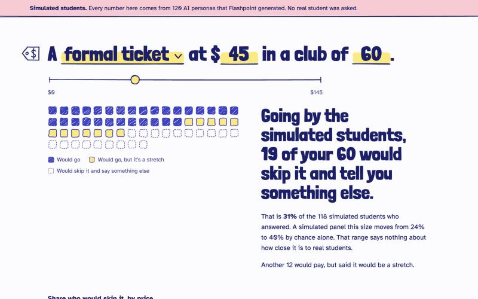
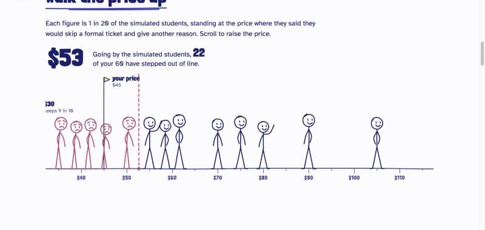

# Priced Out

Students who can't afford a club's dues, formal or trip rarely say so. They say they're
busy, and stop showing up. The people setting the price never find out.

Priced Out is a calculator for club treasurers. It takes a survey that asks students for
the price at which that happens, and gives the treasurer the answer before the price is
announced: at this price, in a club this size, about this many members would quietly skip
it.

Built by one person for the Flashpoint AI x Columbia AI Club hackathon (November 2026),
Engineering & Product track.

**Try it: https://institutor.github.io/priced-out/** · [Write-up](docs/submission/write-up.md) ·
[The survey](https://flashpointopinions.com/0a4c06d5-1ea1-43dd-89d7-2458c955b58a)






## Read this first: the numbers are simulated

**No real student has answered the survey.** Every number on the site comes from a
Flashpoint synthetic panel: 120 AI personas that Flashpoint generated to resemble Columbia
and Barnard undergraduates, each answered by a language model (`gpt-5.4-mini`). Flashpoint
itself marks the panel `uncalibrated`, meaning it has not been checked against real
answers.

So the site is a working product on simulated input, not a finding about students. It says
so in a banner on every screen, in every sentence that quotes a number, and on the printed
receipt. The survey is live and the same code reads real answers the moment there are any
(see [Rebuild the data](#rebuild-the-data-from-a-flashpoint-export)).

## What it does

One page, in the order a treasurer would use it.

1. **Price check.** Fill in the line "A *formal ticket* at $*45* in a club of *60*", guess
   how many would skip it, then see the answer: a room of seats that empties, the share
   behind it with a 95% interval, and the whole curve from $0 up.
2. **Walk the price up.** Twenty stick figures stand along a ruler of prices, each at the
   price where 1 in 20 said they would skip. The strip stays put while you scroll: the
   view closes in, the price climbs, and everyone it passes steps out of line.
3. **What it would take.** The highest price that loses no more than 1 in 10, and what a
   lower access price would bring back, in people and in dollars.
4. **The fix they picked.** Six ways to offer a lower price (sliding scale, waiver on
   request, open waiver code, pay what you can, paid-forward tickets, discount draw),
   ranked by a trade-off question.
5. **Would members cover it themselves?** Many say they'd add a few dollars to their own
   ticket, but only if enough others do. The page plays that out for your club and counts
   how many empty seats the pool pays for.
6. **The receipt for a year in your club.** Dues, formal and trip on one printable slip,
   with the share lost at each line and at any line.
7. **What these numbers are, and what they are not.** Who answered, and what the numbers
   can't tell you.

An eighth section, what priced-out students said at the time, is built and tested but is
shown only when the answers come from people. An invented person's excuse is not evidence.

The title page draws itself: a strip of stick figures in which one member says "Sorry,
can't make it." Scrolling on closes the view in on that one while the rest of the page
slides up over it. Anyone who has asked their device for less motion gets a page that
holds still, and the walk becomes a strip to scroll sideways.

## How it uses Flashpoint

Flashpoint did all of the research work: it designed, checked, hosted and published the
survey, built the MaxDiff design, generated the panel, ran it and exported the answers. I
reached it over MCP, paying per call in USDC from a wallet ([`flashpoint.mjs`](flashpoint.mjs)).

Everything sent and everything that came back is in this repository, with the payment
receipt inside each reply. Sixteen paid calls, $6.50 in total.

| # | What I asked | Tool | Sent | Reply | Cost |
|---|---|---|---|---|---|
| 02 | Design the survey from my brief | `tool_survey` | [brief](briefs/02-draft.txt) | [reply](replies/02-draft.json) | $0.50 |
| 03 | Check whether an untouched slider is stored as $0, and get ready to publish | `tool_survey` | [brief](briefs/03-publish.txt) | [reply](replies/03-publish.json) | $0.50 |
| 05 | Generate 120 personas and run them through the survey | `panel` | [brief](briefs/05-panel.json) | [reply](replies/05-panel.json) | $0.60 |
| 06 | Every persona stopped after the first question. Why? | `tool_survey` | [brief](briefs/06-diagnose.txt) | [reply](replies/06-diagnose.json) | $0.50 |
| 07, 08 | Publish the survey | `tool_survey` | [07](briefs/07-publish.txt), [08](briefs/08-confirm.txt) | [07](replies/07-publish.json), [08](replies/08-confirm.json) | $1.00 |
| 09, 11 | Run the panel again | `panel` | | [09](replies/09-panel-run.json), [11](replies/11-panel-run.json) | $0.20 |
| 13 | It still stops. Find the real cause in the responses and fix it | `tool_survey` | [brief](briefs/13-fix.txt) | [reply](replies/13-fix.json) | $0.50 |
| 14 | Confirm the corrected survey | `tool_survey` | [brief](briefs/14-confirm.txt) | [reply](replies/14-confirm.json) | $0.50 |
| 15, 16 | Run and export (the corrected survey turned out not to be live yet) | `panel`, `tool_survey` | [16](briefs/16-export.txt) | [15](replies/15-panel-run.json), [16](replies/16-export.json) | $0.60 |
| 17, 18 | Confirm until the corrected survey is live | `tool_survey` | [17](briefs/17-confirm.txt), [18](briefs/18-confirm.txt) | [17](replies/17-confirm.json), [18](replies/18-confirm.json) | $1.00 |
| 20 | Run the panel: **120 of 120 completed** | `panel` | | [reply](replies/20-panel-run.json) | $0.10 |
| 21 | Export that run, with the MaxDiff design and the answer codes | `tool_survey` | [brief](briefs/21-export.txt) | [reply](replies/21-export.json) | $0.50 |

### What Flashpoint built

From one written brief, a 13-block survey that validated with no errors:

- two **price questions** for each of three items (the price where it starts to feel like
  a stretch, the price where you'd skip it and give another reason), in three blocks that
  **rotate** per respondent
- a **MaxDiff** question over the six fixes: six screens of four, in ten designs that
  Flashpoint derived itself so that every fix is shown four times
- follow-up questions shown only when they apply (**display logic**)
- an **AI-moderated** closing question, limited to two follow-ups and told not to ask for
  anything identifying
- a **synthetic panel** of 120 personas. Its split by gender follows the US adult
  population. Age, race, education and income were invented by the generator, with no
  correlation modelled between them. Flashpoint states all of this itself in
  [its reply](replies/05-panel.json).

### What Flashpoint changed in my design

- I planned to reuse its Van Westendorp pricing question with two custom price points.
  Flashpoint answered that the type needs exactly four points with fixed meanings, and
  built two price sliders per item instead, each ending in "this much or more". The site's
  rule for the top of a price range comes from that: an answer at the maximum never counts
  as priced out.
- I asked whether a slider nobody touches is stored as $0, which would read as "would skip
  it even if it were free". Flashpoint checked, found that it is, and replaced all six
  sliders with number inputs that start empty.

### What I found out about the synthetic panel runner

The first four panel runs each returned 120 responses, and every one of them ended at the
first question: 480 responses with nothing in them to use.

Flashpoint's first explanation was that the survey was still a draft. Publishing it
changed nothing. Asked to look at the responses themselves, it found the real cause: **the
synthetic panel runner walks the survey's pages in document order and does not evaluate
skip rules or terminate blocks first.** My screener sent non-students to a "thank you,
this survey is for students" page, which sat directly after the first question. A person
in a browser never sees that page unless the rule sends them there. Every persona walked
straight into it.

The fix was to delete that page. "I am not a Columbia or Barnard student" is now an
ordinary answer, and my reader drops those rows instead. The next run completed 120 of
120. One thing I checked afterwards: the two follow-up questions with display conditions
were answered only by the personas they applied to (88 and 97 of 120), so display
conditions did hold in the completed run.

Two smaller things worth knowing if you build on this: a publish needs a reply of the bare
word `confirm`, sometimes twice, and a confirm with any other text in it starts the
publish over. [`go.mjs`](go.mjs) handles both.

The site itself never calls Flashpoint. It is static, so nothing costs money or can fail
while someone is looking at it.

## What the simulated panel answered

These are the panel's answers, quoted to show the whole pipeline working. They are not
evidence about students and no price should be set from them.

- A $45 formal ticket: 37 of the 118 personas who gave a price would skip it (31%), and
  another 23 called it a stretch. $30 dues: 57 of 118 (48%). A $200 trip: 71 of 118 (60%).
- The highest price that loses no more than 1 in 10: $10 for dues, $30 for the formal, $70
  for the trip.
- Of the six fixes, **open waiver code** scored highest (+0.29) and **waiver on request**
  lowest (−0.33). Having to ask is the thing the personas avoided.
- 97 of 120 said they would add something to their own ticket to cover someone else. 66 of
  those said only if enough other members did the same.

## Run it

Needs Node 22 or newer. The site and the tests use no packages.

```bash
git clone https://github.com/institutor/priced-out.git
cd priced-out
npm test
npm run dev
```

Then open http://localhost:4173.

`npm install` is only needed for the scripts that talk to Flashpoint (`flashpoint.mjs`,
`ask.mjs`, `panel.mjs`, `go.mjs`).

## Rebuild the data from a Flashpoint export

Every number on the site comes from one file, `site/data/dataset.json`, built from the CSV
that Flashpoint exports. Raw exports go in `data/raw/`, which is git-ignored.

```bash
# A synthetic panel run. This is the command that built the dataset in this repository.
npm run build-data -- data/raw/panel-run-20.csv \
  --panel replies/20-panel-run.json \
  --survey 0a4c06d5-1ea1-43dd-89d7-2458c955b58a \
  --from 2026-11-20 --to 2026-11-20

# A survey of people: the same, without --panel.
npm run build-data -- data/raw/export.csv \
  --survey 0a4c06d5-1ea1-43dd-89d7-2458c955b58a \
  --from 2026-11-21 --to 2026-11-28
```

One export can hold both people and personas. The two are never mixed: with `--panel` only
the synthetic rows are read and the dataset is marked `simulated`; without it only the rows
from people are read. The script prints how many rows it set aside and why, and stops with
a clear message if a column is missing, an answer isn't one it knows, or a MaxDiff pick
isn't on the screen its design says was shown.

[`data/mapping.json`](data/mapping.json) says which export column is which question, and
holds the ten MaxDiff designs.

To go back to generated sample data: `npm run sample`.

## Talking to Flashpoint

```bash
npm install
cp .env.example .env            # then fill in the wallet key
node flashpoint.mjs balance     # free
node flashpoint.mjs tools       # free
node ask.mjs <name>             # sends briefs/<name>.txt to the survey agent, $0.50
node panel.mjs run <name>       # runs the saved panel through the survey again, $0.10
node go.mjs --dry               # shows the remaining scripted steps and sends nothing
```

Each script saves the reply to `replies/`, keeps the survey, conversation and panel ids in
`replies/state.json`, and refuses to send, and pay for, the same thing twice.

## Environment variables

| Name | Needed for | Example |
|---|---|---|
| `FLASHPOINT_WALLET_KEY` | Paid Flashpoint calls only | `0xYOUR_WALLET_PRIVATE_KEY` |
| `PORT` | Optional port for `npm run dev` (default 4173) | `4173` |

Copy `.env.example` to `.env`. `.env` is git-ignored. The site, the tests and the data
build need no key.

## How the numbers are worked out

- **Priced out** at a price: the skip price is at or below it.
- **Stretched**: not priced out, and the stretch price is at or below it.
- An answer at the top of a price range means "this much or more". It never counts inside
  the range, and prices on the site stop one step below the top.
- A blank answer is missing, never zero. Someone who gave no skip price for an item is left
  out of that item.
- A skip price of $0 is read as no answer: skipping something that is free is not about
  the price. The build prints how many it set aside.
- The figures on the receipt are all worked out over the same respondents: those who gave
  a price for every line that is ticked.
- Shares carry 95% Wilson intervals. For a simulated panel the page says what that interval
  is: how much a panel this size moves by chance, and nothing about how close it is to real
  students.
- Fix scores are best-minus-worst counts over times shown, with a bootstrap interval.
- Nothing is shown for fewer than 5 respondents. Fewer than 20 real answers overall puts
  an "early results" banner on every screen.
- People are whole: "19 of your 60" is the share times the club size, rounded, and the
  dollar figures and pledge rounds are worked out from those whole people.

The rules live in `site/js/lib/` and are covered by the tests in `test/` (131 tests).

## Privacy

- The survey is an anonymous public link. It asks for no name, no email, and nothing about
  income or financial aid.
- The published dataset holds one row per respondent with only their price answers and
  pledge answer, sorted by content so the order says nothing about who answered when. Year
  in school, the officer question, anything typed and the AI chat transcript are counted
  into totals or dropped before the file is written. A test checks the published file for
  exactly this.
- Raw exports stay in `data/raw/`, which is git-ignored.

## Limits

- The numbers are simulated. A language model's idea of a student on a tight budget is not
  a student on a tight budget.
- With real answers, students who open a link in a group chat would still not be a random
  sample of the campus, and what people say they would do can differ from what they do.
- It is not a way to find the highest price people will tolerate, and it can't tell you
  why one particular member said they were busy.

## What's where

```
site/                 the page: index.html, css/, js/, data/dataset.json
site/js/lib/          the rules (curve, pledge cascade, intervals, wording), shared with Node,
                      sketch.js and figure.js, the geometry every drawing is made from, and
                      walk.js, where the line of figures stands and how the scroll is spent
site/js/ui/           one module per section of the page, plus the title page (cover.js and
                      scene.js, its strip of stick figures), whatever follows the scroll
                      (scroll.js) and the pen that draws under and over the page (ink.js,
                      doodles.js)
scripts/              build-data (export to dataset), make-sample, dev server
scripts/lib/          CSV reader, Flashpoint export reader, MaxDiff scoring, aggregation
test/                 node:test suites
briefs/, replies/     everything sent to and received from Flashpoint
flashpoint.mjs        the MCP client that pays per call
ask.mjs, panel.mjs    send one brief to the survey agent, run the synthetic panel
go.mjs                the publish, run and export steps in order
data/mapping.json     which export column is which question, and the MaxDiff designs
docs/                 design, build plan, submission write-up
```

## AI tools used

- **Flashpoint** (primary): designed, validated, hosted and published the survey, built
  the MaxDiff design, generated and ran the synthetic panel, and exported its answers.
  The panel's answers were written by `gpt-5.4-mini`, the model Flashpoint ran it on.
- **Claude Code** (Anthropic): wrote the code, tests and documents in this repository with
  me, and drafted the briefs I sent to Flashpoint.

No AI runs in the live site. Every respondent in the data is AI-generated, and the site
says so wherever a number appears.
