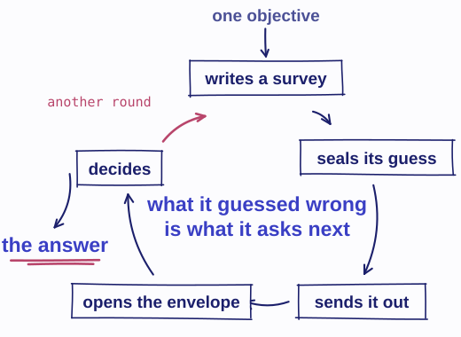

# The Sealed Envelope: an agent that does the research

Built for the Flashpoint MCP Challenge.

## In 60 seconds

**One objective in, an answer out.** You give the agent one sentence, a list of people to
email, and a budget. Through the Flashpoint MCP it decides what survey to make, sends it
to the list, reads the answers, runs a follow-up round on what it learned, and comes back
with a recommendation.

<p align="center"></p>

| | In the example run |
|---|---|
| **The objective given** | "Figure out the best event to put on for our club next spring." |
| **Who was at the keyboard** | Nobody. It was a hands-off run: the code checked each survey before it was sent. |
| **What it started with** | Six lessons it wrote itself at the end of two earlier runs. Its plan says which ones it is acting on. |
| **Survey 1, the agent's choice** | Rank six kinds of event, pick a time, say what you would do if it cost money, and one open question on what keeps you away. Sent to all 8 people. |
| **What it guessed, sealed before sending** | A social dinner or party would come top. |
| **What surprised it** | The social dinner came last. A skills workshop and a guest speaker tied for first. Shift work and "cliquey" socials kept people away. |
| **Survey 2, on that surprise** | Three questions: workshop, speaker, or the two combined? The most you would pay? Which topic? |
| **The recommendation** | A weekday evening with a professional guest: a short talk, then a hands-on part, free or cheap. Skip the social dinner. |
| **How much it did alone** | 20 steps on its own. It did not stop for a person once, and the code never had to step in. |
| **Cost** | Nothing, as a practice run. At real prices its ten messages come to $5.00 of the $9.00 budget. A real run needs a few more messages, about $7 for two rounds. |

**That example is a practice run.** An AI stand-in played Flashpoint and invented every
answer, so it is not a finding. It shows what the agent decides and how. No real run has
been made yet.


- **Watch it, part by part:** <https://institutor.github.io/priced-out/agent/>
  (press **P** on that page for present mode)
- **Or let it play by itself, with captions, in about three minutes:** <https://institutor.github.io/priced-out/agent/?play>
- **What the agent decided, on one page:** [examples/practice-run/summary.md](examples/practice-run/summary.md)
- **Every message, reply and decision:** [examples/practice-run/log.md](examples/practice-run/log.md)

## What it does

A run goes like this. The research decisions are the agent's: what to ask, what it
expects, what the answers mean, whether to ask again, and when to stop.

1. **You give one objective**, a list of people to email, a budget, and any standing
   orders.
2. **The agent plans.** Before it spends anything it writes down what it needs to find
   out, what it expects, and what would change its answer. The code will not let it
   message Flashpoint until it has.
3. **It writes the survey.** It decides what to ask and has Flashpoint build a panel from
   your list and write the survey. It may rehearse the survey on AI personas first.
4. **It seals its guess.** It writes down what it expects people to answer. You can seal
   a guess too, and the agent cannot see yours. If it rehearsed on personas, their
   answers go in as a third guess.
5. **The survey goes out.** Flashpoint emails the list. Before that, either you read the
   survey and type yes, or, in hands-off mode, the code checks it against fixed rules.
6. **The envelope is opened.** The agent reads the results and lays each guess beside
   what people really said. It writes a debrief: who was wrong, what surprised everyone,
   and what is still unknown.
7. **It decides the next move.** Whatever was guessed wrong is what nobody understood
   yet, so that is what a second, shorter survey asks about. Or it stops.
8. **It answers.** A recommendation, the evidence, a scoreboard of the guesses, the
   limits, and up to three lessons it keeps for its next run.

The sealed envelope is what makes the second round worth sending. A follow-up is only
useful if it asks about something the first round got wrong, and the envelope is a
record, made before the answers came in, of what everyone expected.

## How to run it

```bash
npm install
cp .env.example .env                                   # then fill in the two keys
cp agent/recipients.example.txt agent/recipients.txt   # then put in your people
```

**A practice run.** An AI stand-in plays Flashpoint and invents the answers, so it sends
no email and spends no Flashpoint credit. It needs only `ANTHROPIC_API_KEY`:

```bash
node agent/agent.mjs "Figure out the best event to put on for our club next spring." --practice
```

**Before a real run**, check that everything is ready. The check is free: it signs in to
Flashpoint, reads the wallet balance and asks the model one word. It sends nothing and
never prints a key or an address:

```bash
node agent/check.mjs
```

**A real run.** It emails the people on the list and spends Flashpoint credit:

```bash
node agent/agent.mjs "Figure out the best event to put on for our club next spring."
```

**A real run, hands-off.** You give the objective and walk away. The agent sends without
asking you, as long as the survey passes the code's send checks (see Safeguards):

```bash
node agent/agent.mjs "Figure out the best event to put on for our club next spring." --hands-off
```

| Option | What it does | Default |
|---|---|---|
| `--practice` | Practice run. An AI stand-in plays Flashpoint and invents the answers. | off |
| `--fake` | Like `--practice`, but Flashpoint's replies are fixed canned text. The agent is still Claude, so it needs the key. | off |
| `--hands-off` | Nobody approves each send. The code checks every survey before it goes out. You agree to this once, at the start. | off |
| `--quiet 3` | Practice only: 3 of the invented people do not answer the first survey until they are reminded, so you can watch the agent meet a low response. | 0 |
| `--cap 9` | The most the run may spend on Flashpoint, in USDC | 9 |
| `--emails 2` | The most emails anyone on the list may get, reminders included | 2 |
| `--recipients file` | Who to survey, one `Name, email` per line | `agent/recipients.txt` |
| `--orders file` | Your standing orders, one `- order` per line | `agent/orders.md` |
| `--resume folder` | Carry on a real run that was stopped | off |

**What a round costs.** Each message to Flashpoint's survey tool is $0.50. A real round
is about seven messages (write, publish, email, a confirm or two on the way, read the
results), so about $3.50. The default budget of $9 covers two rounds. The agent will not
start a round it cannot pay for, and it will not send a survey if it would have no money
left to read the answers.

While the agent waits for answers, press Enter to make it look now. You can type a note
first, and the agent will read it. The wait ends by itself too.

### Stopping and coming back

People can take hours to answer. You do not have to keep the agent running. Stop it with
Ctrl+C at any point, and carry on later from the run's folder:

```bash
node agent/agent.mjs --resume agent/runs/<folder>
```

The agent picks up with everything it knew: the survey, the sealed envelope, your
guesses, and what it has spent. The log gets a "resumed" step. If it was stopped in the
middle of a paid step, that step is counted as paid to be safe, and the agent is told to
ask Flashpoint where the survey stands before it repeats anything, so nobody is emailed
twice. A run can only be carried on with the same recipient list it started with, and a
practice run can never be carried on as a real one.

## Standing orders

You are the commander: the person who gave the objective. Orders are rules, not steps.
They are in [`orders.md`](orders.md), and you can change them:

```
- Check with me before any email goes out.
- Come to me if the answers split evenly and you cannot call it.
- Tell me what you learned before you start a second round.
```

When an order applies, the agent stops, quotes the order, says what it found, and waits
for your reply. Between orders it does not ask what to do next. With `--hands-off` the
orders become "I am away. Every decision is yours", unless you give your own file.

## It learns from one run to the next

At the end of a run the agent writes down up to three lessons about how to do the
research better, such as "rank questions gave a clearer signal than single choice on 8
people". They are saved to `agent/memory/lessons.md`. The next run reads the newest
lessons before it plans, and its log says which ones it was given. Practice runs keep
their own notebook, which is not in the repository, so an invented answer can never
teach a real run anything.

You can follow the notebook across the five practice runs in [examples/](examples/),
in the order they were run:

| Run | What it started with | What happened |
|---|---|---|
| 1. [A commander approves each send](examples/practice-run-with-a-commander/summary.md) (an AI stand-in played the commander) | Nothing. | Wrote: "Rank questions gave a clearer signal than single choice, which split on 8 people." |
| 2. [Another objective, hands-off](examples/practice-run-members/summary.md) | The 3 lessons from run 1. | Wrote: "Ask openly about uncomfortable incidents." |
| 3. [The example above, hands-off](examples/practice-run/summary.md) | 6 lessons. Its plan says: "Acting on notes: use ranking, price framing, open barriers question." | Guessed a social event would win. It came last. Wrote: "Don't assume social events are favoured." |
| 4. [The same objective again](examples/practice-run-second-try/summary.md) | 8 lessons, that one among them. | Its hunch this time: "Social event is not necessarily top; practical/skill workshop may win." That guess was marked right. |
| 5. [A third objective, with 3 of 8 people silent](examples/practice-run-low-response/summary.md) (`--quiet 3`) | 8 lessons. | Only 5 of 8 answered. It did not spend its second email on a reminder. It sent a forced trade-off follow-up, as an earlier note advised, and all 8 answered that. |

What this shows, and what it does not: the notes are read, later plans name the ones
they use, and run 4 guessed better than run 3 on the same objective. It is five practice
runs with invented answers, so it cannot show that the notes caused that. Runs 1, 2 and
4 were each asked once by the code to think again before stopping after one round; runs
3 and 5 chose their follow-up without that.

## The agent's tools

The agent is Claude Sonnet 5.5 in a loop. Each turn it reads everything so far, picks one
tool, and writes down why.

| Tool | What it does | Cost |
|---|---|---|
| `plan` | Writes down what it needs to know, its hunches, and what would change its answer. Required before the first paid step. | free |
| `ask_flashpoint` | One message to Flashpoint's `tool_survey` over MCP: make the panel, write or change the survey, publish, email, read results | $0.50 |
| `rehearse_on_personas` | Runs the draft on AI personas with Flashpoint's `panel` tool | $0.60 |
| `seal_predictions` | Seals the agent's, the personas' and the commander's guesses | free |
| `open_envelope` | Opens the envelope once the real results are in | free |
| `debrief` | Records what the envelope taught the agent and its next move | free |
| `ask_commander` | Speaks to the commander and waits for a reply | free |
| `wait_for_replies` | Waits for people to answer | free |
| `make_deck` | A short slide deck from Flashpoint's `presentation` tool | $0.25 |
| `finish` | Ends the run with the answer, the scoreboard and the lessons | free |

The agent's instructions say what Flashpoint can do, what a step costs, and a few
limits: keep a survey short, keep a follow-up to about three questions, and spend a
second round only on what the first one got wrong. They also say that one round rarely
settles it, and that the first survey should open by saying a short follow-up may come.
They do not say what to ask, what to guess, whether to rehearse, what the follow-up is
about, or when to stop. Those are the agent's decisions.

**One nudge, and it is counted.** If the agent chooses to stop after a single round
while it still names something unknown and has the budget for a short second round, the
code asks it once to think again. It asks at most once in a run, the agent may still
stop, and the log, the summary and the page all show that it happened. It did not happen in the
example run above. It did happen in three of the other practice runs: the agent chose
to stop, was asked once, and then chose a short follow-up.

**Slips.** Every paid step carries a slip: the price, and the decision of the agent's
that the step could change. If it cannot name one, it is told to skip the step.

## Safeguards

These are rules in the code. They hold whatever the model says.

- **No email without a yes, or a check.** The code refuses any send until the envelope is
  sealed and you have seen the survey and typed yes. In hands-off mode the code checks
  the survey itself instead, and holds the send if any check fails:
  - Flashpoint showed the whole survey, and nothing changed after that.
  - It is short: about 10 questions at most, and about 5 for a follow-up.
  - It does not ask for a name, a contact detail, income, financial aid or anything else
    personal.
  - The round's envelope is sealed.
  - Nobody has had more emails than the limit, and the budget covers it.
- **A limit on emails.** A follow-up round is a second email to the same people, who are
  doing you a favour. The code counts every send and refuses one that would pass the
  limit: two emails each by default, reminders included (`--emails 1` allows a single
  survey and no follow-up). The agent is also told to say in the first survey that one
  short follow-up may come, and to keep a follow-up to three questions at most. The
  code's own check is looser (about five), so look at the length when you approve.
- **A hard budget.** The code refuses any paid step that would pass the budget. A call
  that fails is not counted.
- **The envelope is honest.** Your guess is kept from the model until the envelope opens.
  A guess cannot be sealed after the survey is sent.[^hash]
- **The model never sees a name or an email address.** It writes `{{RECIPIENTS}}` and the
  code puts the list in. Names and addresses are also removed from Flashpoint's replies
  and from anything you type before the model or the log sees them. Only Flashpoint
  receives them.
- **Invented numbers are flagged.** A number in the final answer that appears in nothing
  Flashpoint or the commander said is listed in the log under "Check these numbers".
- **Synthetic stays synthetic.** Persona answers are labelled synthetic everywhere and the
  agent is told never to count them as evidence.
- **Every step is logged** to `agent/runs/<time>/log.md` and `steps.json`, with the
  payment receipt link for each paid step and a bill at the end. A real run also keeps
  Flashpoint's raw replies in a `raw/` folder that is git-ignored, since they can hold
  addresses.

[^hash]: The envelope's SHA-256 fingerprint is written to the log when it is sealed and
    checked when it is opened. It is a record inside one run, not proof to an outsider.

## The objective given, and what the agent decided

**No real run has been made yet.** The example is a practice run: an AI stand-in played
Flashpoint and invented every answer. It is labelled wherever it speaks. Nothing in it
is a finding.

The objective given:

> Figure out the best event to put on for our club next spring.

It was run hands-off, so nobody was at the keyboard. What the agent decided:

- **The plan.** It needed to know which kind of event members want most, what would
  bring them or keep them away, and anything they disliked before. Its hunch was that a
  social or outdoor event would win. It also wrote which of its own notes from earlier
  runs it was acting on: use ranking, test the price wording, ask about barriers openly.
- **Survey 1.** One survey to all 8 people: rank six kinds of event, pick a time, say
  what you would do if the event cost money, and an open question on what keeps you
  away. Its opening line said one short follow-up might come.
- **The envelope.** It guessed a social dinner or party would come top.
- **The send.** Nobody approved it. The code checked the survey against fixed rules
  first: short, no personal questions, and the same survey the agent had been shown.
- **What came back.** The social dinner came last, with no first-place votes. A skills
  workshop and a guest speaker tied for first. Weekday evening was the best time. Open
  answers named shift work, Saturday jobs and "cliquey" socials. The agent wrote "I
  predicted social dinner on top; it ranked last".
- **Stop or go on?** It chose a second round by itself, to break the tie: "a 3-question
  follow-up forcing a trade-off between workshop, speaker and a hybrid, plus price".
- **Survey 2.** Workshop, speaker, or a workshop led by a working professional with a
  short talk first? The most you would pay? Which topic?
- **What came back.** Speaker 3, combined 2, workshop 1, none 2. Its guess that the
  combined event would win was wrong, and it said so. Its price guess was right.
- **Stopping.** Everyone had had their two emails, so there could be no third survey. It
  said so, and said the choice between speaker and workshop "is still soft".
- **The recommendation.** A practical career and money skills evening with a
  professional guest: a short talk, then a hands-on part. Weekday evening, free or under
  about $10 to $25. Skip the social dinner. It said plainly that 8 people give a
  direction, not a measurement.
- **Its lessons for next time.** Do not assume social events are the favourite. A
  hybrid option did not break a tie, so force the trade-off in the first round. Keep an
  open question on barriers.
- **The bill.** Ten messages to Flashpoint: $5.00 of a $9.00 budget. A real run needs a
  few more messages, because the real Flashpoint asks for a confirm on the way.

The whole run is in [examples/practice-run/](examples/practice-run/): the
[one-page summary](examples/practice-run/summary.md) and the
[log](examples/practice-run/log.md), with every message, reply, slip, envelope and
debrief. The same run is on the page at <https://institutor.github.io/priced-out/agent/>.

Four more practice runs are kept beside it, and the page can show each of them:

- [The same objective with a commander approving each send](examples/practice-run-with-a-commander/summary.md).
  An AI stand-in played the commander. Here the standing orders did their work: the
  agent reported before its second round, and went to the commander when the answers
  split evenly.
- [Another objective](examples/practice-run-members/summary.md): "Members come to one
  meeting and then stop. Find out why, and what one change would bring them back."
  Nothing in the agent says what to ask, so it wrote a different survey.
- [The same objective again](examples/practice-run-second-try/summary.md), after the
  example above had added its lessons to the notebook. This run also records the
  agent's answer after each round, so you can see it move.
- [A low response](examples/practice-run-low-response/summary.md): "Our club's
  newsletter gets opened by almost nobody. Find out what members would actually read,
  and how often." Three of the eight people did not answer the first survey, and the
  agent had to choose between a reminder and a follow-up.

### What a run leaves behind

Every run writes three things into its folder under `agent/runs/`: `log.md` (every
message, reply and receipt), `summary.md` (one page on what the agent decided, and how
much it did alone), and `steps.json` (the same steps as data). A folder that starts with
`practice-` or `fake-` is a practice run. It holds no real answers and is not in the
repository.

```bash
node agent/summary.mjs agent/runs/<folder>        # remake the summary
node agent/publish-run.mjs agent/runs/<folder>    # put the run on the page
```

The page is `site/agent/`. It reads `site/data/agent-run.json`, which `publish-run.mjs`
writes. A run that still holds an email address is refused, and a practice run is
labelled as one above everything else on the page.

## How it is built

| File | What it is |
|---|---|
| `agent.mjs` | The command. Reads the keys, the list and the orders, runs the commander's prompts at the keyboard, and talks to the real Flashpoint. |
| `loop.mjs` | The agent loop: its tools, its instructions, the send gate and send checks, the envelope, the budget, the email limit and the redaction. It touches no network and no keyboard. |
| `memory.mjs` | The lessons notebook: reads the newest lessons before a run and writes new ones after it. |
| `log.mjs` | Turns the steps into the run's log. |
| `summary.mjs` | Turns the steps into a one-page summary of what the agent decided. |
| `check.mjs` | The free check before a real run. |
| `publish-run.mjs` | Puts one run on the page, `../site/agent/`. |
| `real-flashpoint.mjs` | Talks to the real Flashpoint over MCP and pays for each call. |
| `fake-flashpoint.mjs` | The stand-in Flashpoint: the same draft, confirm, send, results steps as the real one. |
| `practice-writer.mjs` | For `--practice`: a small AI model writes the stand-in's survey text and invents the answers. |
| `orders.md` | The standing orders. |
| `../flashpoint.mjs` | The organizers' starter client: wallet sign-in, MCP calls, x402 payment. |
| `../test/agent*.test.mjs` | Tests of the loop, the log, the summary, the notebook and the page's story, run with `npm test`. |

## Limits

- The people surveyed here are a few test addresses, so an answer is a direction and not
  a measurement, and the scoreboard shows the method working, not a finding. The agent is
  told to say so.
- The commander's guess is only a fair bet when other people answer the survey. If you are
  answering it yourself from test addresses, press Enter to skip your guess.
- Flashpoint's guide says to allow about a day for replies. A short wait works here only
  because the testers answer straight away.
- The agent reads Flashpoint's written summary of the results, not the raw export.
- A persona rehearsal is slow and can fail. The run carries on without it, and the
  personas then have no guess in the envelope.
- A real send has not been made yet. The code was tested against replies saved from
  earlier real Flashpoint calls and against the stand-in.
